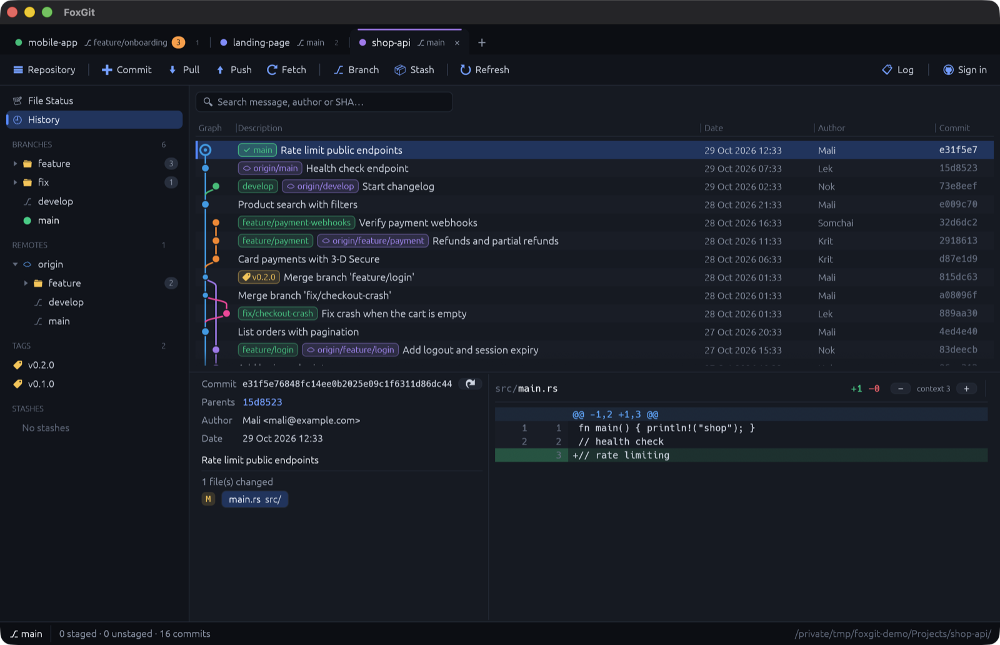

<p align="center"></p>

<h1 align="center">FoxGit</h1>

<p align="center">โปรแกรม Git แบบ Sourcetree ที่เร็ว เบา และใช้ง่าย — macOS · Windows · Linux</p>

<p align="center"><a href="../../releases/latest"><b>⬇ ดาวน์โหลดเวอร์ชันล่าสุด</b></a></p>



## ดาวน์โหลดและติดตั้ง

ไปที่หน้า [**Releases**](../../releases/latest) แล้วเลือกไฟล์ตามเครื่อง

| เครื่อง | ไฟล์ | วิธีติดตั้ง |
|---|---|---|
| **macOS** 11 ขึ้นไป (Apple Silicon และ Intel) | `FoxGit-x.y.z-macos.dmg` | เปิดไฟล์ แล้วลาก FoxGit ไปไว้ใน Applications |
| **Windows** 10/11 (64-bit) | `FoxGit-x.y.z-windows-x64.zip` | แตกไฟล์ แล้วเปิด `FoxGit.exe` (วางไว้โฟลเดอร์ไหนก็ได้) |
| **Ubuntu / Debian** | `foxgit_x.y.z_amd64.deb` | `sudo apt install ./foxgit_*.deb` |
| **Linux อื่น ๆ** (x86-64) | `FoxGit-x.y.z-linux-x64.tar.gz` | แตกไฟล์ แล้วรัน `./install.sh` (ไม่ต้องใช้ root) |

**ต้องมี Git ในเครื่อง** ถ้ายังไม่มี FoxGit จะขึ้นแถบเตือนพร้อมปุ่มดาวน์โหลด
- macOS: `xcode-select --install` (หรือ `brew install git`)
- Windows / Linux: https://git-scm.com/downloads

**เปิดครั้งแรก**
- **macOS** ถ้าขึ้นว่า "cannot be opened / developer cannot be verified" ให้คลิกขวาที่ FoxGit แล้วเลือก **Open** หรือไปที่ System Settings → Privacy & Security → **Open Anyway** (ทำครั้งเดียว)
- **Windows** ถ้า SmartScreen ขึ้นว่า "Windows protected your PC" ให้กด **More info** → **Run anyway**
- ถ้าล็อกอิน GitHub ไว้ macOS อาจถามสิทธิ์เข้า Keychain ให้กด **Always Allow**

FoxGit เช็กเวอร์ชันใหม่ให้เองวันละครั้ง ถ้ามีจะมีปุ่ม **Update** สีเขียวขึ้นที่ toolbar

## ความสามารถ


| ส่วน | ทำอะไรได้ |
|---|---|
| **แท็บโปรเจกต์** | เปิดหลาย repo ในหน้าต่างเดียวแบบแท็บเบราว์เซอร์ มีจุดสีประจำโปรเจกต์ บอก branch, จำนวนไฟล์ที่ยังไม่ commit และ ↑↓ ที่ต้อง push/pull ลากเรียงได้ เปิดโปรแกรมใหม่ได้แท็บเดิมกลับมาครบ |
| **History** | กราฟ commit สีตาม branch, ป้าย branch/remote/tag, ค้นหาจากข้อความ/ผู้เขียน/SHA, **ลากปรับความกว้างคอลัมน์ได้** (ดับเบิลคลิกเส้นแบ่งเพื่อคืนค่าเดิม) |
| **Branch แบ่งโฟลเดอร์** | `feature/login`, `feature/ui` รวมอยู่ในโฟลเดอร์ `feature` ทั้ง branch ในเครื่องและ remote กดยุบ/ขยายได้ |
| **File Status** | stage / unstage / discard ทีละไฟล์ **ทีละ hunk หรือทีละบรรทัด** (คลิกหรือลากเลือกบรรทัด + / −) รองรับ CRLF, ไฟล์ไม่มี newline ท้ายไฟล์, encoding ที่ไม่ใช่ UTF-8 และชื่อไฟล์ภาษาไทย |
| **Commit** | Amend, "Commit & Push" ทีเดียว, ⌘/Ctrl + Enter |
| **Branch / Remote** | สร้าง, checkout, merge, rebase, ลบ, push (ตั้ง upstream / force-with-lease), pull (merge/rebase), fetch, clone, auto-fetch ทุกแท็บใน background |
| **ตั้ง remote ทีหลัง** | repo ที่สร้างในเครื่อง (`git init`) กด **Add remote…** ใน sidebar แล้วใส่ URL หรือเลือก **Create on GitHub** ให้สร้าง repo บน GitHub แล้วผูก + push ให้ในขั้นตอนเดียว คลิกขวาที่ remote เพื่อแก้ชื่อ/URL หรือลบ |
| **คลิกขวาที่ commit** | checkout, สร้าง branch/tag, merge, cherry-pick, revert, reset (soft/mixed/hard), คัดลอก SHA |
| **บัญชี GitHub** | กด **Sign in** แล้ววาง Personal Access Token (มีลิงก์สร้าง token ที่ติ๊กสิทธิ์ให้แล้ว) เก็บใน Keychain ของระบบ push/pull ไป github.com ไม่ต้องใส่รหัสอีก |
| **Clone จาก GitHub** | หน้า **Projects → Remote** แสดง repo ทั้งหมดที่บัญชีมีสิทธิ์ (ของตัวเอง, org, ที่เป็น collaborator) ค้นหาแล้วกด Clone ได้เลย |
| **อื่น ๆ** | Stash, Tag, ธีมมืด/สว่าง, หน้าต่าง Log ดู output ของ git, ถาม passphrase/รหัสผ่านผ่านหน้าต่าง, ภาษาไทยแสดงผลได้ |

<p align="center"> </p>

### ปุ่มลัด

| ปุ่ม (macOS ใช้ ⌘ แทน Ctrl) | ทำอะไร |
|---|---|
| `Ctrl + T` | หน้า Projects (เปิดโปรเจกต์ในแท็บใหม่) |
| `Ctrl + W` | ปิดแท็บ |
| `Ctrl + Tab` / `Ctrl + Shift + Tab` | แท็บถัดไป / ก่อนหน้า |
| `Ctrl + 1…8`, `Ctrl + 9` | ไปที่แท็บที่ 1–8, แท็บสุดท้าย |
| `Ctrl + O` | เปิด repository |
| `F5` | รีเฟรช |
| `↑` / `↓` | เลื่อนเลือก commit |
| `Ctrl + Enter` | Commit |
| ดับเบิลคลิก branch / ไฟล์ | Checkout / Stage–Unstage |

### ทำไมถึงเร็ว

- อ่าน history, branch, status และ diff ผ่าน **libgit2** ในโปรเซสเดียวกัน (repo 5,000 commits โหลดพร้อมกราฟใน ~70 ms) และโหลดใน background thread หน้าจอไม่ค้าง
- รายการ commit และ diff วาดเฉพาะแถวที่อยู่บนจอ ลื่นแม้ diff ยาวหลายหมื่นบรรทัด
- GUI วาดด้วย GPU (egui) ไม่ใช่ Electron
- คำสั่งที่เขียนข้อมูล (commit, push, pull, merge …) เรียก `git` ในเครื่อง hooks, GPG signing, SSH key, git-lfs และ credential manager จึงทำงานเหมือนใน Terminal (เปิดจาก Finder/Dock ก็ใช้ PATH เดียวกับ Terminal)

## สำหรับนักพัฒนา

### Build จากซอร์ส

ต้องมี [Rust](https://rustup.rs) 1.95 ขึ้นไป, Git และ C compiler (macOS: `xcode-select --install`, Windows: Visual Studio Build Tools, Ubuntu: `sudo apt install build-essential pkg-config libxkbcommon-dev libgl1-mesa-dev libx11-dev libwayland-dev`)

```bash
cargo run --release                    # เปิดโปรแกรม
cargo run --release -- ~/work/api ~/work/web   # เปิดหลาย repo เป็นแท็บ
cargo test                             # เทสต์ (สร้าง repo ชั่วคราวด้วย git จริง)
scripts/bundle-macos.sh --universal --dmg      # FoxGit.app + .dmg (macOS)
scripts/demo-repos.sh                  # repo ตัวอย่างใน /tmp สำหรับลองเล่น / ถ่ายภาพหน้าจอ
```

ปล่อยเวอร์ชันใหม่: ดู [docs/RELEASING.md](docs/RELEASING.md) (push tag แล้ว GitHub Actions build ให้ครบทุกระบบ)

### โครงสร้างโค้ด

```
src/
├── main.rs        จุดเริ่มโปรแกรม, หน้าต่าง, icon, crash log, ย้ายข้อมูลจากชื่อเดิม
├── app.rs         state ของแอป, toolbar, dialog, คิวงาน background, ปุ่มลัด, About, เช็กอัปเดต
├── theme.rs       สีและสไตล์ธีมมืด/สว่าง, widget ที่วาดเอง
├── tabs.rs        แถบแท็บ + หน้า Projects + สแกนหา repo
├── views.rs       sidebar, History (กราฟ + คอลัมน์ปรับขนาดได้), File Status, กล่อง commit
├── branchtree.rs  จัด branch เป็นโฟลเดอร์ตาม `/`
├── diffview.rs    ตัวแสดง diff + stage ทีละ hunk/บรรทัด
├── graph.rs       อัลกอริทึมจัดเลนของกราฟ commit
├── git.rs         backend: อ่านด้วย libgit2, เขียนด้วย git CLI
├── github.rs      GitHub API, Keychain, credential ให้ git
├── account.rs     หน้าต่าง Sign in, เมนูบัญชี, หน้า Remote
├── askpass.rs     หน้าต่างถามรหัสผ่านให้ git/ssh
├── shellenv.rs    PATH จาก login shell + ตรวจว่ามี git
└── update.rs      เช็กเวอร์ชันใหม่จาก GitHub Releases
```

อยากเพิ่มคำสั่ง git: เพิ่ม variant ใน `enum Op` (`git.rs`), ใส่คำสั่งใน `Op::run` แล้วเรียก `actions.push(Action::Run(Op::...))` จาก UI

### ข้อจำกัดตอนนี้

- ยังไม่มีหน้าช่วยแก้ conflict (มีแถบเตือนและปุ่ม Abort merge)
- เปิดโปรแกรมซ้ำจะได้หน้าต่างใหม่ (ยังไม่มีโหมดหน้าต่างเดียว)
- stage ทีละ hunk/บรรทัดได้เฉพาะไฟล์ที่แก้ไข (ไฟล์ใหม่/ลบ/conflict ต้อง stage ทั้งไฟล์)
- ไม่รองรับ bare repository
- repo ของ org จะขึ้นในหน้า Remote เฉพาะเมื่อ token มีสิทธิ์เข้าถึง (fine-grained token: เลือก org เป็น resource owner, classic token ของ org ที่ใช้ SSO: กด Configure SSO → Authorize ที่ token นั้น)

## License

[MIT](LICENSE) · ส่วนประกอบโอเพนซอร์สที่ใช้: [THIRD-PARTY-LICENSES.txt](THIRD-PARTY-LICENSES.txt) (รวม libgit2 และฟอนต์ที่มากับ egui)
