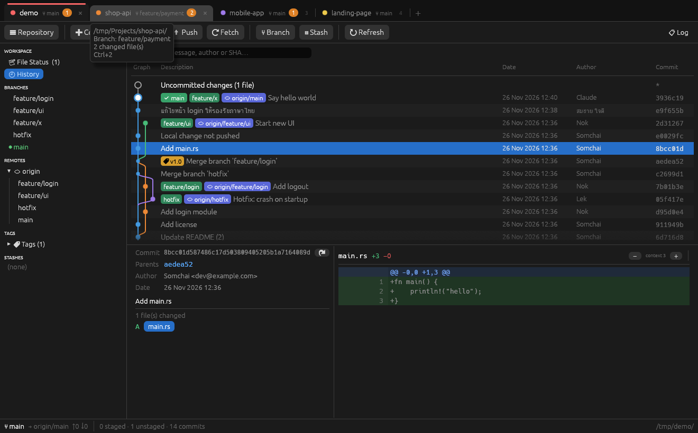
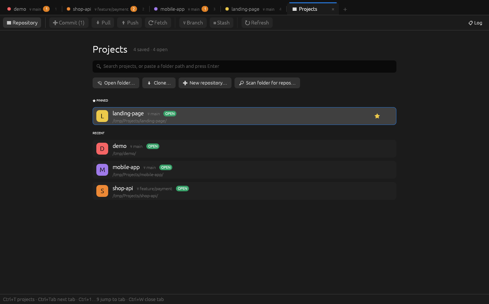
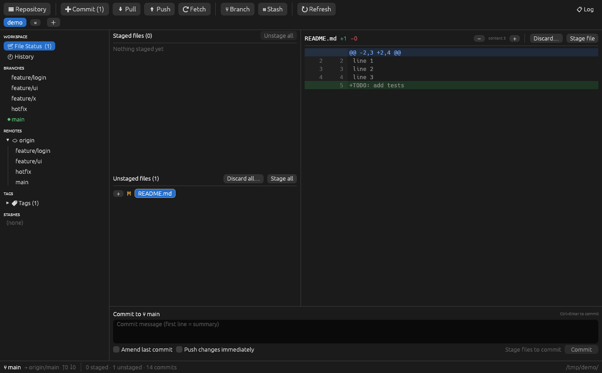
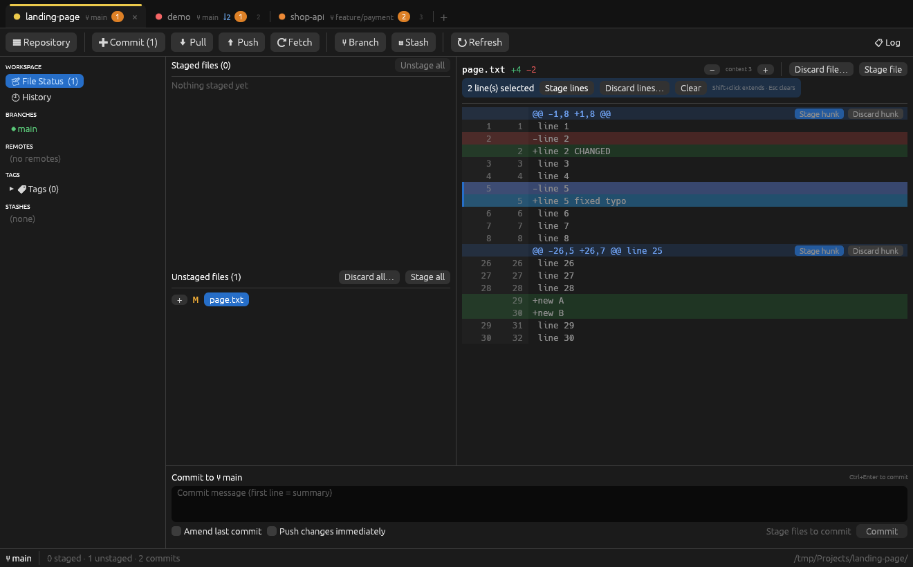

# RustTree 🌳

โปรแกรม Git GUI แบบ Sourcetree เขียนด้วย Rust ทำงานเร็วและกินแรมน้อย ใช้ได้บน Windows, macOS และ Linux





## แท็บโปรเจกต์ (เปิดหลายโปรเจกต์ในหน้าต่างเดียว)

- **แท็บแบบเว็บเบราว์เซอร์**: แต่ละแท็บมีจุดสีประจำโปรเจกต์ บอก branch ปัจจุบัน มีป้ายสีส้มบอกจำนวนไฟล์ที่ยังไม่ commit และ ↑↓ บอกจำนวน commit ที่ต้อง push/pull จึงไม่ต้องเปิดเข้าไปดูทีละแท็บ
- **ลากแท็บเพื่อเรียงลำดับใหม่**, คลิกปุ่มกลางเมาส์เพื่อปิด, คลิกขวาเพื่อปิดแท็บอื่น / ปิดแท็บทางขวา / ปักหมุด / เปิดโฟลเดอร์ / คัดลอก path
- เปิดโปรแกรมใหม่จะ**ได้แท็บเดิมกลับมาครบ** ตามลำดับเดิม และกลับมาที่หน้าต่างเมื่อไหร่ ทุกโปรเจกต์จะรีเฟรชเอง
- **หน้า Projects** (กด `+` หรือ `Ctrl+T`): พิมพ์ค้นหาชื่อโปรเจกต์แล้วกด Enter ได้เลย หรือวาง path ของโฟลเดอร์ก็ได้ ปักหมุด ★ โปรเจกต์ที่ใช้บ่อยไว้บนสุด และมีปุ่ม "Open all pinned" เปิดโปรเจกต์ที่ปักหมุดทั้งหมดในครั้งเดียว
- **Scan folder for repos**: เลือกโฟลเดอร์ เช่น `~/Projects` แล้วโปรแกรมจะหา Git repo ทุกตัวข้างในมาใส่รายการให้ (ข้าม `node_modules`, `target` และโฟลเดอร์ที่ซ่อนอยู่)
- เปิดหลายโปรเจกต์จาก command line ได้: `rusttree ~/work/api ~/work/web ~/work/app`

## ใหม่ในเวอร์ชันนี้

### Stage ทีละ hunk / ทีละบรรทัด



- ในหน้า File Status แต่ละ hunk ของ diff มีปุ่ม **Stage hunk** และ **Discard hunk** (ถ้าเป็นไฟล์ที่ stage แล้วจะเป็น **Unstage hunk**)
- **เลือกเฉพาะบรรทัด**: คลิกที่บรรทัด + หรือ − (หรือลากผ่านหลายบรรทัด, Shift+คลิกเพื่อเลือกต่อ) จะมีแถบ **Stage lines / Discard lines / Unstage lines** ขึ้นมา กด Esc เพื่อยกเลิกที่เลือก
- ใช้ `git apply` จริง ไม่แตะบรรทัดที่ไม่ได้เลือก รองรับไฟล์ CRLF, ไฟล์ที่ไม่มี newline ตอนท้าย, encoding ที่ไม่ใช่ UTF-8 (เช่น TIS-620) และชื่อไฟล์ภาษาไทย
- Discard ทุกแบบมีหน้าต่างให้ยืนยันก่อน
- ไฟล์ใหม่ ไฟล์ที่ลบ และไฟล์ที่ conflict ยังต้อง stage ทั้งไฟล์

### หน้าต่างใส่รหัสผ่าน / token
- ถ้า push / pull / fetch ต้อง login (HTTPS) หรือ SSH key มี passphrase โปรแกรมจะเด้งหน้าต่างถาม ช่องรหัสผ่านซ่อนตัวอักษร
- ติ๊ก "Remember" แล้วจะจำไว้**ในหน่วยความจำ**จนกว่าจะปิดโปรแกรม (ไม่เขียนลงดิสก์) ถ้ารหัสผิด โปรแกรมจะลืมรหัสนั้นแล้วถามใหม่ในครั้งต่อไป
- ถ้าเครื่องมี credential helper อยู่แล้ว (เช่น Git Credential Manager บน Windows/macOS) git จะใช้ตัวนั้นก่อนตามปกติ
- ทำงานโดยตั้งตัวโปรแกรมเองเป็น `GIT_ASKPASS` / `SSH_ASKPASS` และคุยกับหน้าต่างหลักผ่าน localhost ที่มี token สุ่มป้องกันไว้

### Auto-fetch ทุกโปรเจกต์
- Fetch ทุกแท็บที่เปิดอยู่ให้เองใน background (ค่าเริ่มต้นทุก 10 นาที รอบแรกประมาณ 30 วินาทีหลังเปิดโปรแกรม) ตัวเลข ↓ บนแท็บจะอัปเดตเอง
- ถ้ามี commit ใหม่บน remote จะมีแจ้งเตือน เช่น "shop-api: 2 new commit(s) on origin/main — Pull to update"
- ตั้งค่าได้ที่เมนู **Repository → Auto-fetch** (ปิด / 5 / 10 / 15 / 30 นาที) และมี **Fetch all open projects now** ให้สั่ง fetch ทุกโปรเจกต์ทันที
- Auto-fetch จะไม่เด้งถามรหัสผ่านมากวน ถ้ายังไม่มีรหัสที่จำไว้ก็ข้ามไปเงียบ ๆ
- เอาเมาส์ชี้ที่แท็บจะเห็นว่า fetch ล่าสุดเมื่อไหร่

## ทำอะไรได้บ้าง

| ส่วน | ความสามารถ |
|---|---|
| **History** | กราฟ commit สีตาม branch, ป้าย branch/remote/tag, ค้นหาจากข้อความ/ผู้เขียน/SHA, เลื่อนด้วยปุ่ม ↑↓, โหลดเพิ่มทีละชุด |
| **รายละเอียด commit** | ข้อมูล commit, parent (คลิกเพื่อไปที่ commit นั้น), รายชื่อไฟล์ที่เปลี่ยน, diff พร้อมเลขบรรทัด, ปรับจำนวนบรรทัด context ได้ |
| **File Status** | แยกไฟล์ staged/unstaged, stage/unstage ทีละไฟล์ ทีละ hunk ทีละบรรทัด หรือทั้งหมด (ดับเบิลคลิกไฟล์ก็ได้), discard (มีหน้าต่างยืนยัน) |
| **Commit** | ช่องพิมพ์ข้อความ, Amend, "Push ทันที", ใช้ Ctrl+Enter เพื่อ commit |
| **Branch** | สร้าง/checkout (ดับเบิลคลิก)/merge/rebase/ลบ, checkout branch จาก remote แบบ tracking, แสดง ↑ahead ↓behind |
| **Remote** | Fetch, Pull (merge หรือ rebase), Push (ตั้ง upstream / force-with-lease ได้), Clone, หน้าต่างใส่รหัสผ่าน/token, Auto-fetch |
| **คลิกขวาที่ commit** | Checkout, สร้าง branch/tag, Merge, Cherry-pick, Revert, Reset (soft/mixed/hard), คัดลอก SHA |
| **อื่น ๆ** | Stash (save/apply/pop/drop), Tag, ธีมมืด/สว่าง, หน้าต่าง Log ดู output ของ git, รีเฟรชอัตโนมัติเมื่อกลับมาที่หน้าต่าง (หรือกด F5) |
| **ภาษาไทย** | ข้อความ commit และชื่อไฟล์ภาษาไทยแสดงผลได้ (ใช้ฟอนต์ของระบบอัตโนมัติ) |

## ทำไมถึงเร็ว

- **อ่านข้อมูล** (history, branch, status, diff) ผ่าน **libgit2** ในโปรเซสเดียวกัน ไม่ต้องเรียกโปรแกรม `git` แยก ทดสอบกับ repo ของ tokio (5,236 commits, 83 branches) โหลด history พร้อมคำนวณกราฟเสร็จใน **~70 ms**
- โหลด history ใน **background thread** หน้าจอจึงไม่ค้าง
- รายการ commit และ diff วาดเฉพาะแถวที่อยู่บนจอ (virtualized) จึงลื่นแม้ diff ยาวหลายหมื่นบรรทัด
- GUI ใช้ **egui** (immediate-mode, วาดด้วย GPU) ไม่มี Electron/เว็บเบราว์เซอร์
- **คำสั่งที่เขียนข้อมูล** (commit, push, pull, merge …) เรียก `git` ที่ติดตั้งในเครื่อง ทำให้ hooks, GPG signing, SSH key และ credential manager ทำงานเหมือนใช้ใน Terminal ทุกอย่าง คำสั่งพวกนี้รันใน background thread

## ติดตั้งและรัน

ต้องมี:
1. **Rust** (1.95 ขึ้นไป — อัปเดตด้วย `rustup update`): https://rustup.rs
2. **Git** ที่เรียกใช้จาก PATH ได้
3. **C compiler** สำหรับ build libgit2 (มีให้อัตโนมัติเมื่อติดตั้ง Rust บน Windows ด้วย Visual Studio Build Tools / บน macOS ใช้ `xcode-select --install`)
   - Linux (Ubuntu/Debian) ต้องติดตั้งเพิ่ม: `sudo apt install build-essential pkg-config libx11-dev libxkbcommon-dev libgl1-mesa-dev libgtk-3-dev`

```bash
cd rusttree
cargo run --release                 # เปิดโปรแกรม
cargo run --release -- /path/to/repo   # เปิด repo ทันที
```

ไฟล์โปรแกรมที่ build แล้วอยู่ที่ `target/release/rusttree` (บน Windows คือ `rusttree.exe`) คัดลอกไปใช้ที่ไหนก็ได้

รันเทสต์: `cargo test`

## ปุ่มลัด

| ปุ่ม | ทำอะไร |
|---|---|
| `Ctrl/Cmd + T` | หน้า Projects (เปิดโปรเจกต์ในแท็บใหม่) |
| `Ctrl/Cmd + W` | ปิดแท็บ |
| `Ctrl + Tab` / `Ctrl + Shift + Tab` | แท็บถัดไป / ก่อนหน้า (หรือ `Ctrl + PageDown/PageUp`) |
| `Ctrl/Cmd + 1…8` | ไปที่แท็บที่ 1–8 (`Ctrl + 9` = แท็บสุดท้าย) |
| `Ctrl/Cmd + O` | เปิด repository |
| `F5` | รีเฟรช |
| `↑` / `↓` | เลื่อนเลือก commit ในหน้า History |
| `Ctrl/Cmd + Enter` | Commit (ขณะพิมพ์ข้อความ commit) |
| ดับเบิลคลิก branch | Checkout |
| ดับเบิลคลิกไฟล์ | Stage / Unstage |
| คลิกปุ่มกลางเมาส์ที่แท็บ | ปิดแท็บ |

## โครงสร้างโค้ด

```
src/
├── main.rs      จุดเริ่มโปรแกรม, ตั้งค่าหน้าต่าง
├── app.rs       state ของแอป, toolbar, dialog, คิวงาน background, ปุ่มลัด
├── tabs.rs      แถบแท็บโปรเจกต์ + หน้า Projects + สแกนหา repo
├── views.rs     sidebar, หน้า History (วาดกราฟ), หน้า File Status, กล่อง commit
├── diffview.rs  ตัวแสดง diff
├── graph.rs     อัลกอริทึมจัดเลน (lane) ของกราฟ commit + เทสต์
└── git.rs       backend: อ่านด้วย libgit2, เขียนด้วย git CLI + เทสต์
```

อยากเพิ่มคำสั่ง git ใหม่: เพิ่ม variant ใน `enum Op` (`git.rs`) แล้วใส่คำสั่งใน `Op::run` จากนั้นเรียก `actions.push(Action::Run(Op::...))` จาก UI ได้เลย

## ข้อจำกัดของเวอร์ชันนี้

- ยังไม่มีตัวช่วยแก้ conflict ต้องแก้ไฟล์เองแล้วค่อย stage และ commit (มีแถบเตือนและปุ่ม Abort merge)
- ไม่รองรับ bare repository
- รหัสที่ติ๊ก Remember จะจำไว้แค่จนปิดโปรแกรม ถ้าอยากจำถาวร ให้ใช้ Git Credential Manager หรือ SSH key
- SSH ที่ถาม passphrase ผ่านหน้าต่างได้ต้องใช้ OpenSSH 8.4 ขึ้นไป (Windows 10/11, macOS และ Linux รุ่นใหม่ ๆ มีให้อยู่แล้ว)
