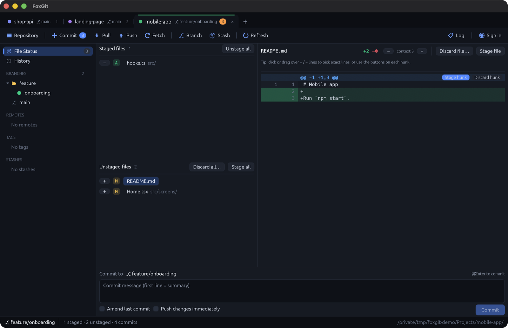
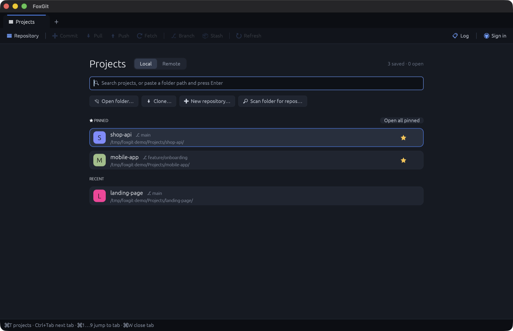
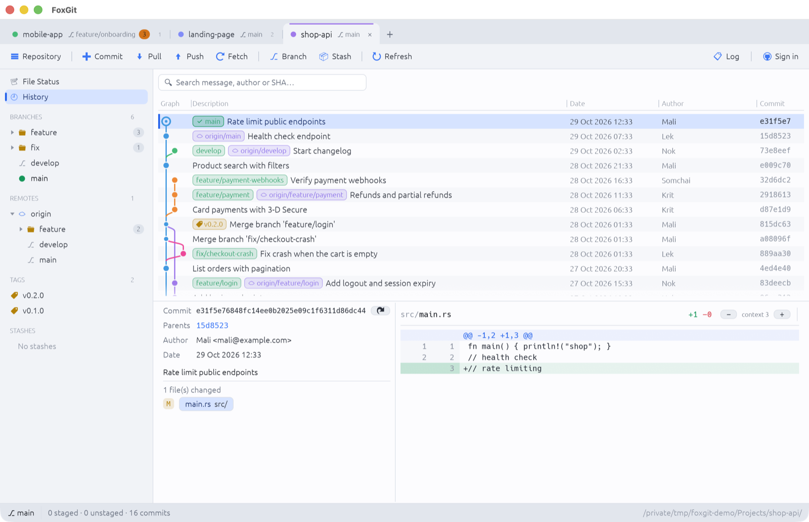

<p align="center"></p>

<h1 align="center">FoxGit</h1>

<p align="center">โปรแกรม Git แบบ Sourcetree ที่เร็ว เบา และใช้ง่าย — macOS · Windows · Linux</p>

<p align="center"><a href="../../releases/latest"><b>⬇ ดาวน์โหลดเวอร์ชันล่าสุด</b></a></p>


## ดาวน์โหลดและติดตั้ง

ไปที่หน้า [**Releases**](../../releases/latest) แล้วเลือกไฟล์ตามเครื่อง

| เครื่อง | ไฟล์ | วิธีติดตั้ง |
|---|---|---|
| **macOS** 11 ขึ้นไป (Apple Silicon และ Intel) | `FoxGit-x.y.z-macos.dmg` | เปิดไฟล์ แล้วลาก FoxGit ไปไว้ใน Applications |
| **Windows** 10/11 (64-bit) | `FoxGit-x.y.z-windows-x64.zip` | แตกไฟล์ แล้วเปิด `FoxGit.exe` (วางไว้โฟลเดอร์ไหนก็ได้) |
| **Ubuntu / Debian** | `foxgit_x.y.z_amd64.deb` | `sudo apt install ./foxgit_*.deb` |
| **Linux อื่น ๆ** (x86-64) | `FoxGit-x.y.z-linux-x64.tar.gz` | แตกไฟล์ แล้วรัน `./install.sh` (ไม่ต้องใช้ root) |

**ต้องมี Git ในเครื่อง** ถ้ายังไม่มี FoxGit จะขึ้นแถบเตือนพร้อมปุ่มดาวน์โหลด
- macOS: `xcode-select --install` (หรือ `brew install git`)
- Windows / Linux: https://git-scm.com/downloads

**เปิดครั้งแรก**
- **macOS** ถ้าขึ้นว่า "cannot be opened / developer cannot be verified" ให้คลิกขวาที่ FoxGit แล้วเลือก **Open** หรือไปที่ System Settings → Privacy & Security → **Open Anyway** (ทำครั้งเดียว)
- **Windows** ถ้า SmartScreen ขึ้นว่า "Windows protected your PC" ให้กด **More info** → **Run anyway**
- ถ้าล็อกอิน GitHub ไว้ macOS อาจถามสิทธิ์เข้า Keychain ให้กด **Always Allow**

FoxGit เช็กเวอร์ชันใหม่ให้เองวันละครั้ง ถ้ามีจะมีปุ่ม **Update** สีเขียวขึ้นที่ toolbar

## ความสามารถ



| ส่วน | ทำอะไรได้ |
|---|---|
| **แท็บโปรเจกต์** | เปิดหลาย repo ในหน้าต่างเดียวแบบแท็บเบราว์เซอร์ มีจุดสีประจำโปรเจกต์ บอก branch, จำนวนไฟล์ที่ยังไม่ commit และ ↑↓ ที่ต้อง push/pull ลากเรียงได้ เปิดโปรแกรมใหม่ได้แท็บเดิมกลับมาครบ |
| **History** | กราฟ commit สีตาม branch, ป้าย branch/remote/tag, ค้นหาจากข้อความ/ผู้เขียน/SHA, **ลากปรับความกว้างคอลัมน์ได้** (ดับเบิลคลิกเส้นแบ่งเพื่อคืนค่าเดิม) |
| **Branch แบ่งโฟลเดอร์** | `feature/login`, `feature/ui` รวมอยู่ในโฟลเดอร์ `feature` ทั้ง branch ในเครื่องและ remote กดยุบ/ขยายได้ |
| **File Status** | stage / unstage / discard ทีละไฟล์ **ทีละ hunk หรือทีละบรรทัด** (คลิกหรือลากเลือกบรรทัด + / −) รองรับ CRLF, ไฟล์ไม่มี newline ท้ายไฟล์, encoding ที่ไม่ใช่ UTF-8 และชื่อไฟล์ภาษาไทย |
| **Commit** | Amend, "Commit & Push" ทีเดียว, ⌘/Ctrl + Enter |
| **Branch / Remote** | สร้าง, checkout, merge, rebase, ลบ, push (ตั้ง upstream / force-with-lease), pull (merge/rebase), fetch, clone, auto-fetch ทุกแท็บใน background |
| **แบ่งโซนชัดเจน** | แถบไอคอนซ้ายสุดสลับโหมด: 📝 **Changes** (stage/commit), 🕘 **History** (กราฟ commit), **GitHub** (PR / issue), 🔍 **Search** (ค้นในไฟล์) และ ✨ **Agents** (แชตกับ AI) แต่ละโหมดมี sidebar ของตัวเอง |
| **Pull request ในโปรแกรม** | โหมด **GitHub**: รายการ PR / issue (open / closed), อ่านคำอธิบาย คอมเมนต์ review, ดู **Files** (patch ทุกไฟล์) และ **Checks** (สถานะ CI), **Merge** (merge / squash / rebase), **Approve**, **Request changes**, คอมเมนต์, ปิด/เปิดใหม่, **Checkout** PR มาเป็น branch `pr/<เลข>` (PR จาก fork ก็ได้) และกด **New pull request** สร้าง PR ได้เลย (push ให้ก่อนถ้ายังไม่ได้ push, เลือก base เป็น default branch ของ GitHub ให้) issue กด **Ask an agent** ให้ AI ทำต่อได้ |
| **CI ของ commit** | เลือก commit ใน History จะเห็นสถานะ CI (✔ / × / กำลังรัน) และลิงก์ไปดูแต่ละ check |
| **แก้ conflict** | ไฟล์ที่ conflict เปิดเป็นการ์ดทีละจุด กด **Use ours / Use theirs / Both** แล้ว **Save & mark resolved** หรือเลือกทั้งไฟล์, เปิดใน editor, ใช้ merge tool แถบด้านบนบอกว่ากำลัง merge / rebase / cherry-pick อยู่ พร้อมปุ่ม **Continue** และ **Abort** |
| **Run (รันโปรเจกต์)** | ปุ่ม ▶ **Run** ที่ toolbar: script ใน `package.json` (ใช้ pnpm / yarn / bun / npm ตาม lockfile), Cargo, Makefile, Go รันใน terminal ด้านล่าง ถ้า dev server พิมพ์ URL `localhost` จะมีปุ่มเปิดในเบราว์เซอร์ |
| **ค้นในไฟล์** | โหมด 🔍 **Search** (`Ctrl + Shift + F`): ค้นด้วย `git grep` (ตัวพิมพ์เล็ก/ใหญ่, ทั้งคำ, regex, ไฟล์ใหม่) คลิกผลลัพธ์เปิด editor ที่บรรทัดนั้น |
| **✨ เขียน commit message ให้** | ปุ่ม **✨ Write message** ในกล่อง commit: Claude Code อ่าน diff ที่ stage ไว้แล้วเขียนข้อความตามสไตล์ commit เดิมของ repo |
| **Command palette** | `⌘K` (macOS) / `Ctrl + Shift + P`: ค้นทุกคำสั่ง โหมด branch script โปรเจกต์ และการตั้งค่าในช่องเดียว |
| **Dashboard** | **Projects → Dashboard**: ทุกโปรเจกต์ที่เปิดอยู่ในหน้าเดียว (branch, ↑↓, ไฟล์ที่แก้, conflict, script ที่รันอยู่, แชต agent) |
| **Settings** | `Ctrl + ,`: ธีม, ขนาดตัวอักษร terminal, editor ที่ใช้, agent เริ่มต้น, auto-fetch, ชื่อ/อีเมลผู้เขียนของ repo นี้ |
| **แก้ไฟล์เร็ว ๆ / หน้าต่างเดียว** | ปุ่ม **Edit** ที่หัว diff แก้ไฟล์ได้ในโปรแกรม (`⌘S` บันทึก) หรือ ↗ เปิดใน editor ที่บรรทัดที่แก้ · สั่ง `foxgit <โฟลเดอร์>` ตอนที่เปิดโปรแกรมอยู่แล้วจะเปิดเป็นแท็บในหน้าต่างเดิม ลากโฟลเดอร์มาวางที่หน้าต่างก็ได้ · แจ้งเตือนของระบบเมื่อ agent ทำงานเสร็จหรือ push/pull เสร็จตอนที่อยู่หน้าต่างอื่น |
| **AI agents (แชตสั่งงาน)** | แถบซ้ายสุด ✨ **Agents → New chat** พิมพ์งานแล้วเลือก **Claude Code / Codex / Hermes** (ตัวที่ลงไว้ในเครื่อง) agent ทำงานในสำเนาแยก (git worktree, branch `agent/…`) ไม่แตะโฟลเดอร์ของคุณ เห็นความคืบหน้าสด พิมพ์คุยต่อได้ตลอด (ระหว่างทำงานข้อความจะเข้าคิว) เสร็จแล้วกด **Review changes** เพื่อคัดเก็บทีละ hunk/บรรทัด แล้ว **Merge** หรือ **Discard** แต่ละแชตมีแท็บ **Terminal** (terminal จริงในสำเนาของ agent กด "Continue in Claude Code" เพื่อเปิด agent แบบเต็มจอต่อ session เดิม), ปุ่ม **Open in Cursor / VS Code / Zed**, **Open in Terminal app** และ **Push & PR** |
| **Agents แบบ workspace** | แต่ละแชตมี 3 แท็บ: **Chat**, **Changes** (ดู diff ทุกไฟล์ที่ agent แก้ เลือกบรรทัดแล้วเขียนคอมเมนต์ ส่งกลับให้ agent แก้ทีเดียว) และ **Terminal** (หลาย terminal ในสำเนาของ agent: หน้าจอเต็มของ agent, shell, script ของโปรเจกต์ + ปุ่มเปิดเบราว์เซอร์) · New chat เลือกโหมด Chat/Terminal, **model**, **profile**, **Plan first** และสั่ง **หลาย agent / หลายรอบพร้อมกัน** แล้วเทียบผลบน **Board** · ช่องพิมพ์มีปุ่มคำสั่งสำเร็จรูป (Write tests, Review yourself, Explain … เพิ่มเองได้ใน Settings), **📎 แนบไฟล์ (@)**, เปลี่ยน model, Plan mode · เมนู ⋯: Rename, Retry with another agent, Update from base, Run tests · **Profiles** แยกบัญชี/ค่าตั้งของ Claude Code / Codex / Hermes |
| **ตั้ง remote ทีหลัง** | repo ที่สร้างในเครื่อง (`git init`) กด **Add remote…** ใน sidebar แล้วใส่ URL หรือเลือก **Create on GitHub** ให้สร้าง repo บน GitHub แล้วผูก + push ให้ในขั้นตอนเดียว คลิกขวาที่ remote เพื่อแก้ชื่อ/URL หรือลบ |
| **คลิกขวาที่ commit** | checkout, สร้าง branch/tag, merge, cherry-pick, revert, reset (soft/mixed/hard), คัดลอก SHA |
| **บัญชี GitHub (หลาย account)** | กด **Sign in** แล้ววาง Personal Access Token (มีลิงก์สร้าง token ที่ติ๊กสิทธิ์ให้แล้ว) เก็บใน Keychain ของระบบ เพิ่มได้หลาย account และสลับได้จากเมนู account ที่ toolbar push/pull ไป github.com ไม่ต้องใส่รหัสอีก repo ที่ clone จาก account ไหนจะใช้ token ของ account นั้นเสมอ (เปลี่ยนได้ที่คลิกขวา remote → GitHub account) |
| **Clone จาก GitHub** | หน้า **Projects → Remote** แสดง repo ทั้งหมดที่แต่ละ account มีสิทธิ์ (ของตัวเอง, org, ที่เป็น collaborator) แยกกลุ่มตาม account ค้นหาแล้วกด Clone ได้เลย |
| **อื่น ๆ** | Stash, Tag, ธีมมืด/สว่าง, หน้าต่าง Log ดู output ของ git, ถาม passphrase/รหัสผ่านผ่านหน้าต่าง, ภาษาไทยแสดงผลได้ |

<p align="center"> </p>

### ปุ่มลัด

| ปุ่ม (macOS ใช้ ⌘ แทน Ctrl) | ทำอะไร |
|---|---|
| `Ctrl + T` | หน้า Projects (เปิดโปรเจกต์ในแท็บใหม่) |
| `Ctrl + W` | ปิดแท็บ |
| `Ctrl + Tab` / `Ctrl + Shift + Tab` | แท็บถัดไป / ก่อนหน้า |
| `Ctrl + 1…8`, `Ctrl + 9` | ไปที่แท็บที่ 1–8, แท็บสุดท้าย |
| `Ctrl + O` | เปิด repository |
| `F5` | รีเฟรช |
| `⌘K` (macOS) / `Ctrl + Shift + P` | Command palette |
| `Ctrl + Shift + F` | ค้นในไฟล์ |
| `Ctrl + ,` | Settings |
| `↑` / `↓` | เลื่อนเลือก commit |
| `Ctrl + Enter` | Commit |
| ดับเบิลคลิก branch / ไฟล์ | Checkout / Stage–Unstage |

### ทำไมถึงเร็ว

- อ่าน history, branch, status และ diff ผ่าน **libgit2** ในโปรเซสเดียวกัน (repo 5,000 commits โหลดพร้อมกราฟใน ~70 ms) และโหลดใน background thread หน้าจอไม่ค้าง
- รายการ commit และ diff วาดเฉพาะแถวที่อยู่บนจอ ลื่นแม้ diff ยาวหลายหมื่นบรรทัด
- GUI วาดด้วย GPU (egui) ไม่ใช่ Electron
- คำสั่งที่เขียนข้อมูล (commit, push, pull, merge …) เรียก `git` ในเครื่อง hooks, GPG signing, SSH key, git-lfs และ credential manager จึงทำงานเหมือนใน Terminal (เปิดจาก Finder/Dock ก็ใช้ PATH เดียวกับ Terminal)

## สำหรับนักพัฒนา

### Build จากซอร์ส

ต้องมี [Rust](https://rustup.rs) 1.95 ขึ้นไป, Git และ C compiler (macOS: `xcode-select --install`, Windows: Visual Studio Build Tools, Ubuntu: `sudo apt install build-essential pkg-config libxkbcommon-dev libgl1-mesa-dev libx11-dev libwayland-dev`)

```bash
cargo run --release                    # เปิดโปรแกรม
cargo run --release -- ~/work/api ~/work/web   # เปิดหลาย repo เป็นแท็บ
cargo test                             # เทสต์ (สร้าง repo ชั่วคราวด้วย git จริง)
scripts/bundle-macos.sh --universal --dmg      # FoxGit.app + .dmg (macOS)
scripts/demo-repos.sh                  # repo ตัวอย่างใน /tmp สำหรับลองเล่น / ถ่ายภาพหน้าจอ
```

ปล่อยเวอร์ชันใหม่: ดู [docs/RELEASING.md](docs/RELEASING.md) (push tag แล้ว GitHub Actions build ให้ครบทุกระบบ)

### โครงสร้างโค้ด

```
src/
├── main.rs        จุดเริ่มโปรแกรม, หน้าต่าง, icon, crash log, ย้ายข้อมูลจากชื่อเดิม
├── app.rs         state ของแอป, toolbar, dialog, คิวงาน background, ปุ่มลัด, About, เช็กอัปเดต
├── theme.rs       สีและสไตล์ธีมมืด/สว่าง, widget ที่วาดเอง
├── tabs.rs        แถบแท็บ + หน้า Projects + สแกนหา repo
├── views.rs       sidebar, History (กราฟ + คอลัมน์ปรับขนาดได้), File Status, กล่อง commit
├── branchtree.rs  จัด branch เป็นโฟลเดอร์ตาม `/`
├── diffview.rs    ตัวแสดง diff + stage ทีละ hunk/บรรทัด
├── graph.rs       อัลกอริทึมจัดเลนของกราฟ commit
├── git.rs         backend: อ่านด้วย libgit2, เขียนด้วย git CLI
├── github.rs      GitHub API (PR, issue, review, CI), Keychain, credential ให้ git
├── account.rs     หน้าต่าง Sign in, เมนูบัญชี, หน้า Remote
├── hub.rs         โหมด GitHub: PR / issue / review / merge / สร้าง PR / CI
├── conflict.rs    หน้าแก้ conflict ทีละจุด + Continue / Abort
├── runner.rs      ▶ Run: หา script ของโปรเจกต์ แล้วรันใน terminal ด้านล่าง
├── search.rs      โหมดค้นในไฟล์ (git grep)
├── palette.rs     Command palette
├── editor.rs      แก้ไฟล์เร็ว ๆ ในโปรแกรม
├── aicommit.rs    ✨ เขียน commit message ด้วย Claude Code
├── agents.rs      แชต AI agent (Claude Code / Codex / Hermes) ใน git worktree, Board, New chat
├── agent_review.rs แท็บ Changes ของแชต agent (diff + คอมเมนต์ส่งให้ agent)
├── prompts.rs     คำสั่งสำเร็จรูป, model, profiles ของ agent
├── terminal.rs    terminal ในตัว (PTY + vt100)
├── desktop.rs     หา editor / terminal app, แจ้งเตือนของระบบ
├── instance.rs    โหมดหน้าต่างเดียว (ส่งโฟลเดอร์ให้หน้าต่างที่เปิดอยู่)
├── askpass.rs     หน้าต่างถามรหัสผ่านให้ git/ssh
├── shellenv.rs    PATH จาก login shell + ตรวจว่ามี git
└── update.rs      เช็กเวอร์ชันใหม่จาก GitHub Releases
```

อยากเพิ่มคำสั่ง git: เพิ่ม variant ใน `enum Op` (`git.rs`), ใส่คำสั่งใน `Op::run` แล้วเรียก `actions.push(Action::Run(Op::...))` จาก UI

### ข้อจำกัดตอนนี้

- คำอธิบาย PR / คอมเมนต์แสดงเป็นข้อความ Markdown ดิบ (ยังไม่จัดรูปแบบ) และยังคอมเมนต์ทีละบรรทัดในโค้ดของ PR ไม่ได้ (ทำบน GitHub)
- ✨ Write message ต้องมี Claude Code (`claude`) ในเครื่อง
- stage ทีละ hunk/บรรทัดได้เฉพาะไฟล์ที่แก้ไข (ไฟล์ใหม่/ลบ/conflict ต้อง stage ทั้งไฟล์)
- ไม่รองรับ bare repository
- repo ของ org จะขึ้นในหน้า Remote เฉพาะเมื่อ token มีสิทธิ์เข้าถึง (fine-grained token: เลือก org เป็น resource owner, classic token ของ org ที่ใช้ SSO: กด Configure SSO → Authorize ที่ token นั้น)

## License

[MIT](LICENSE) · ส่วนประกอบโอเพนซอร์สที่ใช้: [THIRD-PARTY-LICENSES.txt](THIRD-PARTY-LICENSES.txt) (รวม libgit2 และฟอนต์ที่มากับ egui)
